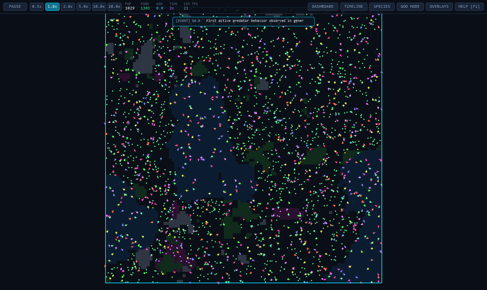
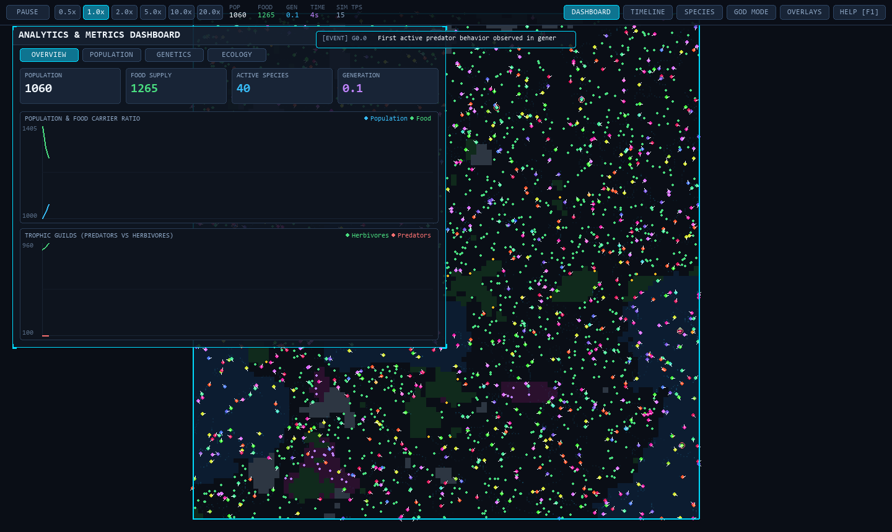
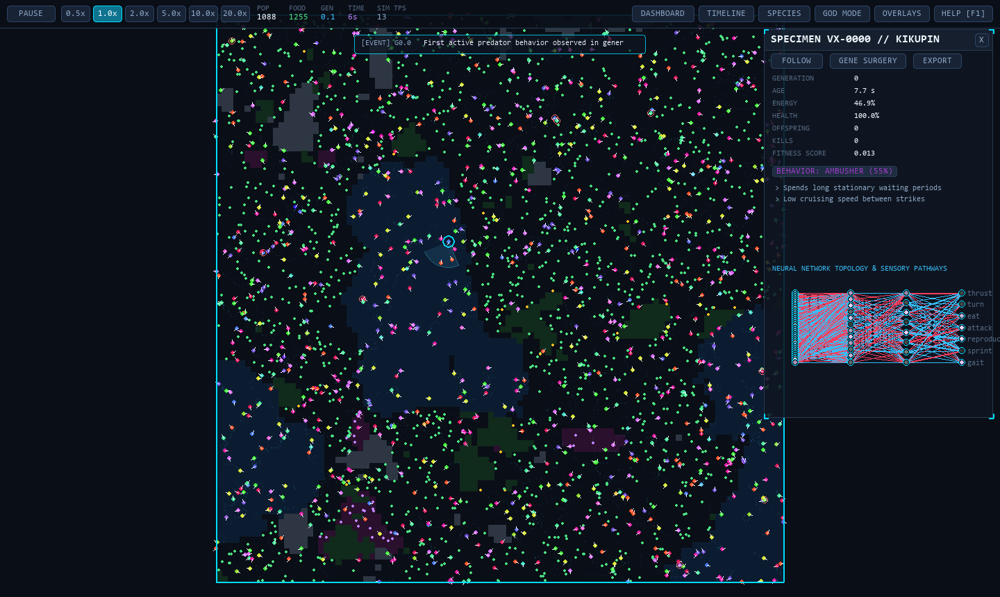
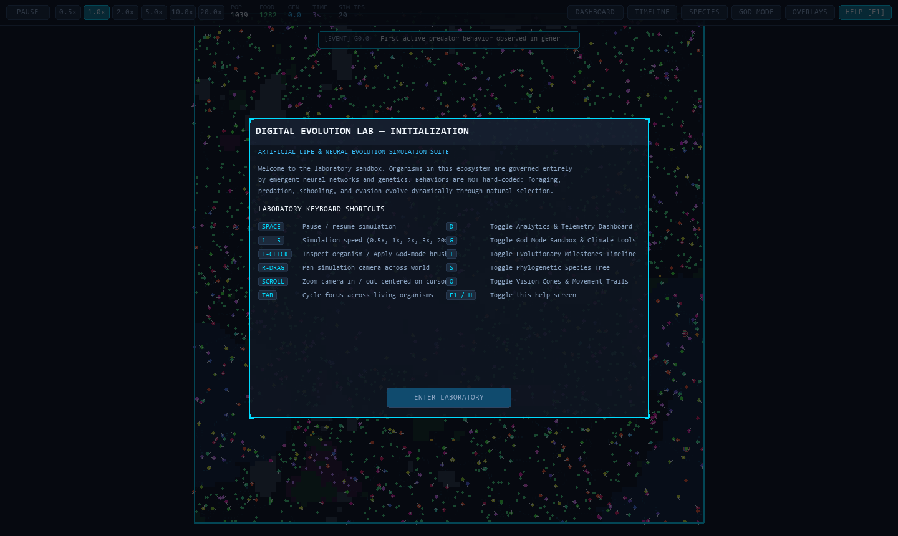

# Digital Evolution Lab

> **High-Performance Artificial Life, Neural Evolution, and Emergent Ecosystem Simulation**  
> Built with vectorized Structure-of-Arrays (SoA) NumPy inference, continuous spatial partitioning, real thermodynamic energy conservation, and a futuristic sci-fi laboratory interface.

---

## 🔬 Core Philosophy: Genuine Emergence

**Digital Evolution Lab** is an artificial life laboratory where thousands of autonomous organisms live, reproduce, compete, and evolve inside a procedurally generated 2D ecosystem.

Crucially: **Behavior is NEVER hard-coded.**
- There are no scripted rules such as `"if predator is near, flee"` or `"if hungry, seek food"`.
- Organisms are driven entirely by **neural networks** whose weights, biases, and structural connection topologies mutate and undergo natural selection across generations.
- **Trophic roles (Herbivory vs. Carnivory)** emerge through metabolic trade-offs and natural selection: carnivory is an energy-assimilation trait governed by genetics, not a programmed script.
- **Fitness is emergent**: there is no artificial objective function. Organisms survive and reproduce solely if they gather enough calories to cover metabolic costs, avoid senescence or predation, and reach reproductive energy thresholds.
- **Thermodynamic Energy Conservation**: Every calorie in the ecosystem (initial spawn, plant growth, grazing, attack costs, metabolic heat dissipation, carcass decay) is tracked by a central ledger with near-zero energy drift ($< 0.005$).

---

## 📸 Laboratory Visuals

| Live Simulation Overview | Real-Time Telemetry Dashboard |
| :---: | :---: |
|  |  |

| Neural Inspector & Gene Surgery | Initial Laboratory Boot Sequence |
| :---: | :---: |
|  |  |

---

## ⚡ Performance Benchmarks

The entire simulation loop is vectorized using Structure-of-Arrays (SoA) memory layouts and a continuous uniform spatial grid:
- **Zero Python object overhead per organism:** Position, velocity, energy, health, traits, and weights reside in contiguous NumPy buffers.
- **Batched Matrix Inference:** Entire populations are processed in a single vectorized forward pass per tick ($O(1)$ Python function calls).
- **Uniform Spatial Grid:** Neighbor and sensory queries run in $O(N)$ expected time via `np.argsort` cell bucketing, eliminating all $O(N^2)$ distance sweeps.

### Measured Throughput (Intel / AMD CPU on Windows)
| Active Population | Simulation Speed | Time Acceleration |
|---|---|---|
| **500 Organisms** | **131.0 steps/sec** | **13.1× real-time** |
| **1,000 Organisms** | **73.2 steps/sec** | **7.3× real-time** |
| **2,500 Organisms** | **18.3 steps/sec** | **1.8× real-time** |
| **5,000 Organisms** | **5.6 steps/sec** | Real-time capable |

*Run benchmarks locally using `python main.py --benchmark`.*

---

## 🎮 Interactive Controls & Keyboard Shortcuts

| Shortcut | Description |
|---|---|
| **`Space`** | Pause / resume simulation |
| **`1` – `5`** | Simulation speed multiplier (`0.5x`, `1.0x`, `2.0x`, `5.0x`, `20.0x`) |
| **`L-Click`** | Select / inspect organism, or apply active God-Mode brush |
| **`R-Drag` / `M-Drag`** | Smoothly pan camera across the continuous world |
| **`Scroll Wheel`** | Smooth zoom in / out centered on cursor position |
| **`Tab`** | Cycle focus to next living specimen |
| **`D`** | Toggle Analytics & Telemetry Multi-Chart Dashboard |
| **`G`** | Toggle God Mode Sandbox & Climate Intervention Panel |
| **`T`** | Toggle Evolutionary Milestones & Event Timeline |
| **`S`** | Toggle Phylogenetic Species Family Tree |
| **`O`** | Toggle Sensory Vision Cones, Heatmaps, and Movement Trails |
| **`F1` / `H`** | Toggle Laboratory Help & Keyboard Shortcuts Dialog |

---

## 🧪 Scientific Experiment Presets

Run specialized evolutionary experiments out of the box:

```bash
# 1. Predator-Prey Lotka-Volterra population cycles
python main.py --experiment predator_prey

# 2. Genetic Bottleneck & diversity recovery
python main.py --experiment bottleneck

# 3. Environmental Stress Timeline (scarcity, heating, invasive species)
python main.py --experiment environmental_timeline

# 4. Evolutionary Arms Race (pursuit vs evasion coevolution)
python main.py --experiment arms_race

# 5. Neuroevolution Maze Navigation
python main.py --experiment maze
```

---

## 💻 Headless Compute & Automated Reports

Run simulations headlessly on clusters or servers without opening a GUI window:

```bash
# Run headless for 200 generations with determinism seed 42
python main.py --headless --generations 200 --seed 42 --export-stats telemetry.csv --report results/
```

### Generated Scientific Artifacts
When `--report <dir>` is specified, the analysis engine automatically compiles:
- `summary.md`: Publication-ready executive summary, empirical observations, and key milestone timeline.
- `population.csv` & `species.csv`: High-resolution demographic and lineage histories.
- `graphs/population_cycles.png`: Matplotlib multi-tier population oscillation curves.
- `graphs/trait_evolution.png`: Trait drift curves across generations (speed, vision, metabolism, size).
- `graphs/genetic_diversity.png`: Pairwise genetic diversity index and active species richness.

---

## 🧬 Neural Network Architecture

Every organism houses a lightweight neural network:
- **Inputs (~24 sensory channels):** Whisker raycasts (left, front, right), vision cone target detection (nearest food distance/bearing, nearest organism bearing/size/speed), energy reserves, health, age, speed, local temperature, water proximity, memory inputs (previous steering, previous thrust, recent danger, recent food EMA).
- **Hidden Layers:** Configurable feed-forward or Elman recurrent mode (hidden activation feedback).
- **Outputs (7 motor channels):** `thrust`, `turn`, `eat`, `attack`, `reproduce`, `sprint`, `gait`.
- **Topological Mutation (NEAT-style):** Individual synaptic connections can be enabled or disabled via masked topology mutations, enabling modular neural complexity to evolve over time.
- **Fail-Safe Quarantine (§55):** Non-finite activations (NaN/Inf) are detected, quarantined, sanitized, and tracked in telemetry logs.

---

## 📦 Installation & Quickstart

### Prerequisites
- Python 3.10+ (Tested on Python 3.12)

### Setup
```bash
git clone https://github.com/your-org/digital-evolution-lab.git
cd digital-evolution-lab
pip install -r requirements.txt
```

### Launch Interactive GUI
```bash
python main.py
```

### Run Automated Test Suite
```bash
pytest -v
```

---

## 🏛️ Project Structure

```
digital-evolution-lab/
├── main.py                      # Root entry point
├── requirements.txt             # Verified dependencies
├── config/                      # Simulation configurations
│   └── default_config.json      # Base parameter defaults
├── src/
│   ├── core/                    # Seeded RNG hub, validated config, utilities
│   ├── neural/                  # NetSpec, vectorized batch forward pass, RNN, NEAT masks
│   ├── evolution/               # Genome traits, mutation, crossover, selection, speciation
│   ├── simulation/              # Continuous ecosystem, SoA organism store, world, spatial grid, food
│   ├── analysis/                # Behavior discovery, statistics recorder, events, automated report
│   ├── rendering/               # Pygame MasterRenderer, smooth camera, particles, overlays
│   │   └── ui/                  # Dashboard, God Mode, Inspector, NN visualizer, Species Tree, Intro
│   └── persistence/             # JSON/gzip state serialization, load engine, replay scrubber
├── tests/                       # Complete automated pytest test suite (29/29 passing)
├── screenshots/                 # Application screenshots (strictly app window surface)
└── experiments/                 # Curated experiment logs, charts, and markdown reports
```

---

## 📜 License

MIT License. Designed and engineered for artificial life research, evolutionary computing, and neuroevolution education.
